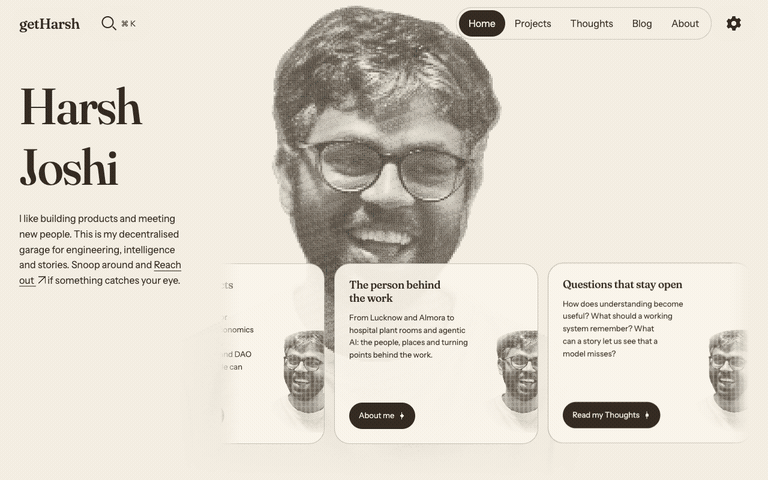

# gazette-theme-chronicle

Chronicle is the Gazette world used by getHarsh: a personal encounter carried by warm stock, soft Fraunces type and exact supporting evidence. Its accepted portrait responds to attention and reveals an aligned figure and world, with complete introduction and onward choices. [WORLD.md](WORLD.md) explains the design, page ranges and chronological studies still to draw.

[](https://getharsh.in/)

The [presentation package](presentation.toml) extends `gazette-theme-base` with values from `design-tokens`’ `chronicle` world. Base owns shared controls and reading behavior; this repository supplies presentation, and the workspace selects content and portrait sources. [Compositions](docs/compositions.md) describes the selectors, portrait bindings and authoring forms.

## Build and check

Bind `theme:chronicle`, `theme:base` and the resources declared by `presentation.toml` in a Gazette workspace. Gazette’s `docs/theme-reference.md` describes the package contract; Base’s `docs/start-a-world.md` explains fixture bindings and its README gives the shared verification command. This package does not build a site by itself.

Change values at `design-tokens`, then run its `npm run build`, `npm run capture` and `npm run check:captures`. [Tokens](tokens/SOURCE.md) and [fonts](fonts/SOURCE.md) record captured inputs and licences; display, reading and system faces are delivered as WOFF2 resources.

Inspect portrait registration, the full head, introduction and choice rail at wide and handheld widths, in both color modes and with reduced motion. Check pointer, keyboard, interrupted reveal and complete resting and print forms; inspect the transition into About and reading. A build proves neither likeness nor design acceptance. Start with [AGENTS.md](AGENTS.md).

### Run the world fixture

`fixtures/footer-policy.py` runs Base's neutral reading fixture through Chronicle, expecting the compact colophon footer on the product listing as Chronicle's templates select it. Every other reading check runs unchanged. It needs a Base checkout (the sibling `gazette-theme-base` by default, or `--base PATH`), the Gazette build under review and a bindings file for the `shared/` inputs declared in `presentation.toml`, in the format Base's [Start a world](https://github.com/getHarshOnline/gazette-theme-base/blob/main/docs/start-a-world.md#check-the-binding) describes:

```sh
python3 fixtures/footer-policy.py --gazette /path/to/gazette --resource-bindings /path/to/bindings.json
```

It does not start a browser or check the portrait, its encounter or appearance; `--keep` retains the rendered workspace for inspection.

## Licence

Chronicle is licensed under the MIT License with an attribution term: a site built with it keeps a footer credit stating that it was made using Gazette, such as "Made using Gazette", linking to [rawthoughts.in/gazette](https://rawthoughts.in/gazette/), and a link to this repository. [LICENSE](LICENSE) gives the full terms and the files that keep their own. The fonts are under the SIL Open Font License 1.1, with each family's licence in [fonts](fonts/).

The preview shows content from the publication this world was made for, which this repository does not license: footage and artwork purchased from a vendor under licence, and the portrait and publication art of [Harsh](https://getharsh.in). All rights reserved; not for reuse from this repository.
